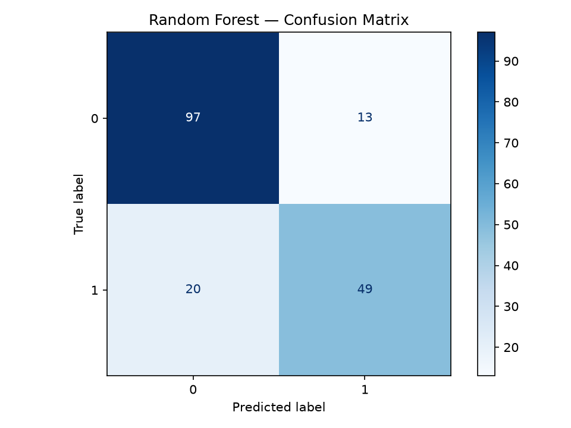
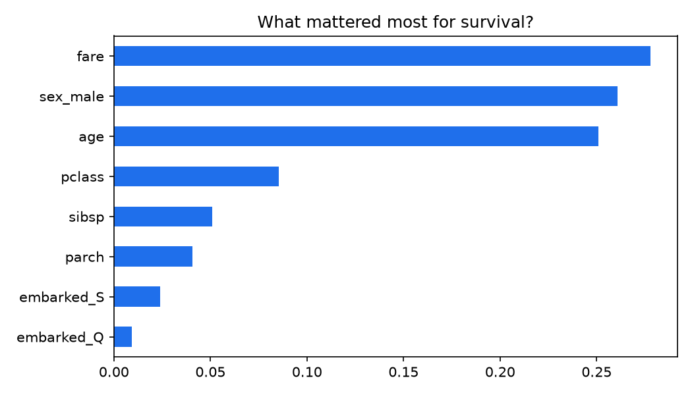

# Titanic Survival Prediction 🚢

Predicting whether a Titanic passenger survived, from their ticket class, sex, age, family size and fare.

## Result
| Model | Accuracy |
|---|---|
| Logistic Regression | 80.4% |
| **Random Forest** | **81.6%** |

## Key finding
Survival was not random — **passenger class, sex and fare** carry most of the signal. Women and first-class passengers survived at far higher rates.

## How it works
1. Load the classic 891-passenger Titanic dataset
2. Clean missing values, one-hot encode `sex` and `embarked`
3. Train/test split (80/20, stratified)
4. Compare Logistic Regression vs Random Forest (300 trees)
5. Evaluate with accuracy + confusion matrix, inspect feature importance

## Run it
Open `titanic_survival.ipynb` in Jupyter or Google Colab and run all cells — the notebook downloads the dataset itself.

**Tools:** Python, pandas, scikit-learn, matplotlib
