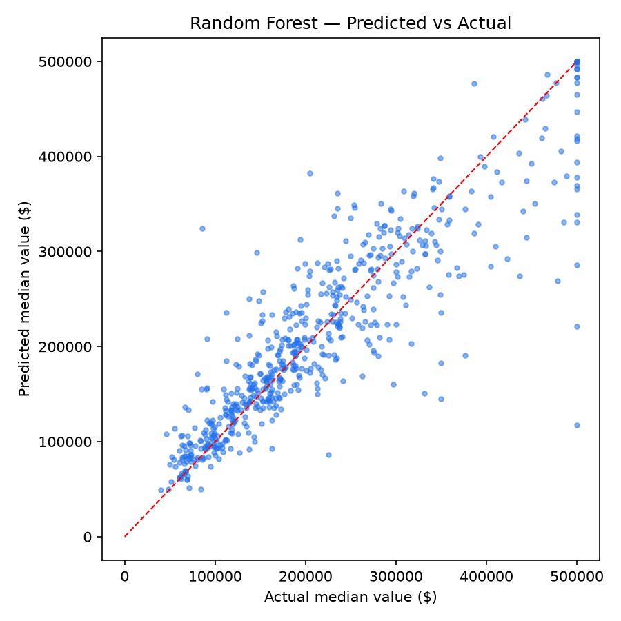

# House Price Prediction 🏠

Predicting the median house value of a California district from location, rooms, population and median income (20,640 districts).

## Result
| Model | MAE | RMSE | R² |
|---|---|---|---|
| Linear Regression | $50,889 | $72,669 | 0.597 |
| **Random Forest** | **$32,181** | **$50,075** | **0.809** |

The Random Forest's typical error is **$32k** on houses worth ~$200k — and it explains 81% of price variation.

## Key finding
**Median income is the strongest single signal** for house prices, location comes next. Engineered features (rooms per household, bedrooms per room, population per household) improved both models — good features beat fancier algorithms.

## How it works
1. Load the California Housing dataset
2. Fill missing values, engineer per-household features, one-hot encode `ocean_proximity`
3. Train/test split (80/20)
4. Compare Linear Regression vs Random Forest (200 trees)
5. Evaluate with MAE, RMSE and R²; plot predicted vs actual

## Run it
Open `house_price_prediction.ipynb` in Jupyter or Google Colab and run all cells — the notebook downloads the dataset itself.

**Tools:** Python, pandas, scikit-learn, matplotlib
