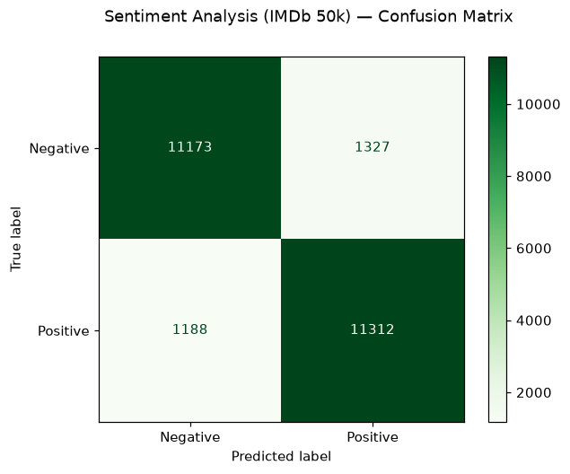

# Sentiment Analysis — IMDb 50,000 Reviews

**What it does:** Reads a full movie review and predicts whether it is **positive** or **negative**.

**Dataset (BIG):** the official IMDb Large Movie Review Dataset — **50,000 full-length reviews** (25,000 train / 25,000 test, perfectly balanced).

**Approach:** Clean the text → TF-IDF (30,000 unigram+bigram features) → Logistic Regression.

**Verified result (executed notebook):**
- **Accuracy: 89.9%** on 25,000 unseen test reviews
- Precision/recall ≈ 0.90 for both classes
- Live demo: 3 of 4 sample reviews classified correctly (the deliberately mixed "okay… but good ending" review fooled it — an honest miss)

> An earlier small version of this project (2,748 short sentences) scored 82.2%. More data + full-length reviews → a clearly stronger model.

**Files:** `sentiment_analysis.ipynb` — notebook with outputs · `confusion_matrix.png`
**Run it:** Open the notebook in Google Colab or Jupyter — it downloads the dataset itself (parquet from Hugging Face).
