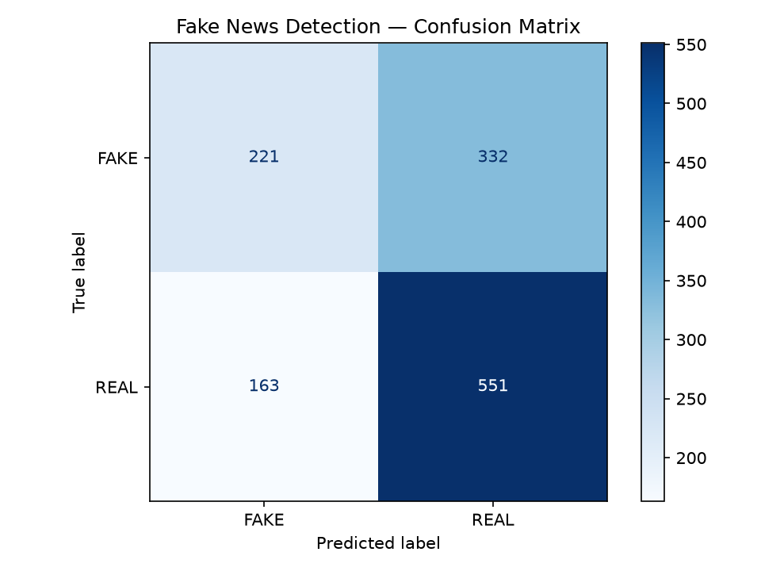

# Fake News Detection 📰

Predicting whether a public statement is likely **REAL** or **FAKE** from its wording alone — and being honest about how far wording alone can take you.

## Result
**Accuracy: 60.9%** on 1,267 untouched test statements (LIAR dataset — 12,800+ PolitiFact fact-checked statements, UC Santa Barbara). The 6 original truth ratings are grouped: true / mostly-true / half-true → REAL; false / barely-true / pants-on-fire → FAKE.

## The honest part
60.9% is well above a coin flip — sensational wording really does correlate with false claims — but it is nowhere near proof. A statement's *style* is not evidence of its *truth*; real fact-checking needs sources. This model is a triage helper, never a judge. Short political claims are also much harder than full news articles: dataset difficulty matters more than model choice.

## How it works
1. Load the LIAR train/test split; binarize the 6-way ratings
2. TF-IDF features (1–2 word phrases, 20,000 features, English stop-words removed)
3. Logistic Regression
4. Evaluate on the untouched test set + a no-cherry-picking demo (the first 8 test statements: 5 of 8 correct, in line with the overall score)

## Run it
Open `fake_news_detection.ipynb` in Jupyter or Google Colab and run all cells — the notebook downloads the dataset itself.

**Tools:** Python, pandas, scikit-learn, matplotlib
