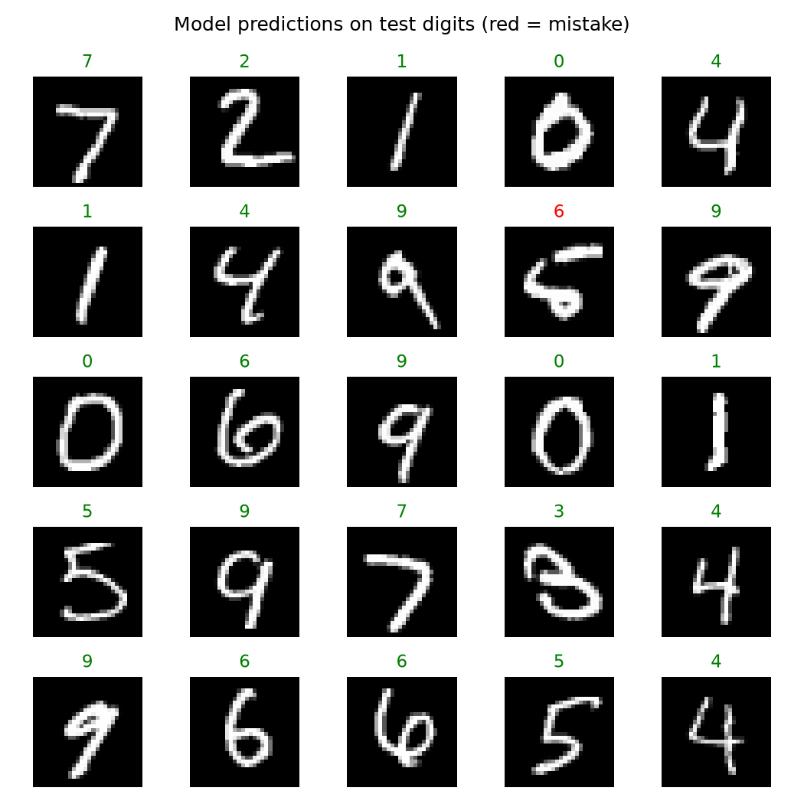

# Handwritten Digit Recognition ✍️

A small neural network that reads handwritten digits (0–9) from 28×28 pixel images — the classic first deep-learning project, on the real MNIST dataset (70,000 digits).

## Result
**Test accuracy: 96.16%** on the full 10,000-image MNIST test set, after training on a 20,000-image subset (so the notebook runs in a few minutes anywhere). 384 mistakes — mostly genuinely ambiguous digits (4 vs 9, 3 vs 5) that humans argue about too.

## How it works
1. Load MNIST, scale pixels to 0–1, flatten each image to 784 numbers
2. Train an MLP neural network (784 → 128 → 10) with scikit-learn
3. Evaluate on the untouched 10,000-image test set
4. Visualize predictions (green = correct, red = mistake) and inspect the errors

## Next steps
Training on all 60,000 images, or switching to a convolutional network (CNN), pushes accuracy toward 99%.

## Run it
Open `mnist_digit_recognition.ipynb` in Jupyter or Google Colab and run all cells — the notebook downloads the dataset itself.

**Tools:** Python, NumPy, scikit-learn (MLPClassifier), matplotlib
