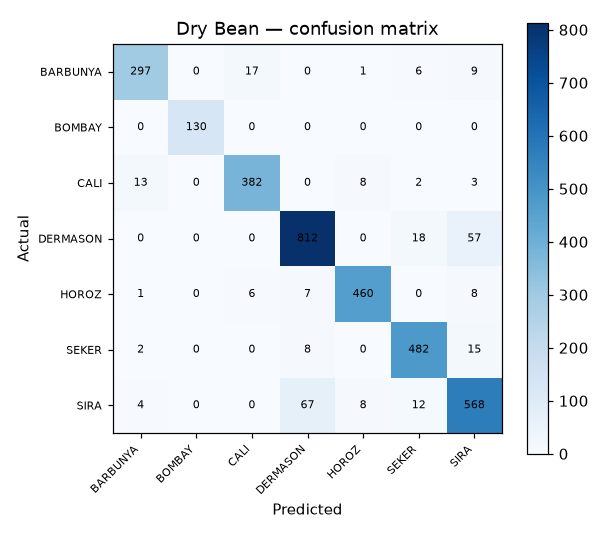

# 35 · Dry Bean Classification

**Result: 92.0% accuracy** (Random Forest, 7 varieties) · Logistic Regression 92.4% · largest-class baseline 26.1%.

## The problem
Seed sorting is a real agricultural industry task. From camera measurements of 13611 beans — shape only, no colour — identify which of 7 varieties each bean is.

## Data
UCI Dry Bean dataset — 16 morphological features per bean (area, perimeter, axis lengths, roundness, solidity…).

## Approach
- Stratified 75/25 split
- Random Forest (300 trees) vs scaled logistic regression

## Run it
Open `dry_bean_classification.ipynb` in Jupyter or Colab; it downloads the UCI dataset itself.

## Stack
Python · pandas · scikit-learn · matplotlib
