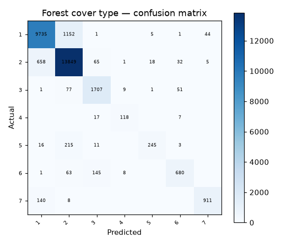

# 36 · Forest Cover Type Classification

**Result: 90.8% accuracy** (Random Forest) · Logistic Regression 72.4% · 7 cover types.

## The problem
Forest managers map tree cover from terrain data. Given elevation, aspect, slope, soil and wilderness attributes for a 30×30 m patch, predict its forest cover type.

## Data
UCI Covertype — 581012 patches, 54 features. Training uses a stratified 120000-row sample (the full dataset behaves the same; this keeps runtimes sane), tested on a held-out 30,000 rows.

## Approach
- Stratified sampling + 75/25 split
- Random Forest (200 trees) vs scaled logistic regression

## Run it
Open `forest_cover_type.ipynb` in Jupyter or Colab; it downloads the UCI dataset itself.

## Stack
Python · pandas · scikit-learn · matplotlib
