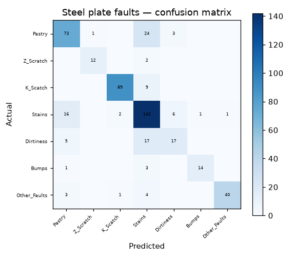

# 37 · Steel Plate Fault Classification

**Result: 79.6% accuracy** (Random Forest) · Logistic Regression 72.2% · 7 fault types.

## The problem
Automated inspection: from 27 measurements of a steel plate, identify which surface fault it has — the first step to fixing the process that caused it.

## Data
UCI Steel Plates Faults — 1941 plates, fault labels one-hot in the last 7 columns.

## Approach
- Stratified 75/25 split
- Random Forest (300 trees) vs scaled logistic regression

## Run it
Open `steel_plates_faults.ipynb` in Jupyter or Colab; it downloads the UCI dataset itself.

## Stack
Python · pandas · scikit-learn · matplotlib
