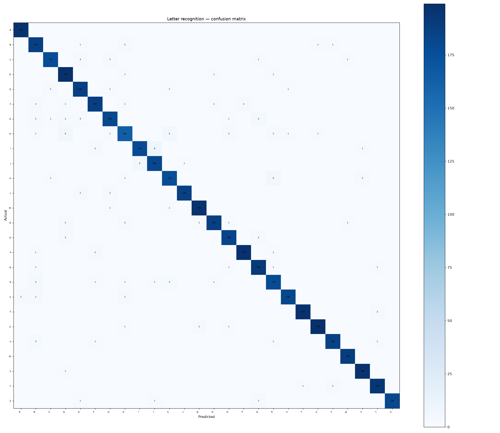

# 40 · Letter Recognition

**Result: 97.0% accuracy** (Random Forest, 26 letters) · Logistic Regression 77.1% · random guessing would score 3.8%.

## The problem
Before deep learning, OCR worked like this: extract hand-designed statistics from a character image, then classify. This is the dataset that benchmarked that era — and the features are good enough that a forest still shines.

## Data
UCI Letter Recognition — 20000 letters, 16 numeric features, distorted across 20 fonts.

## Approach
- Stratified 75/25 split
- Random Forest (300 trees) vs scaled logistic regression

## Run it
Open `letter_recognition.ipynb` in Jupyter or Colab; it downloads the UCI dataset itself.

## Stack
Python · pandas · scikit-learn · matplotlib
