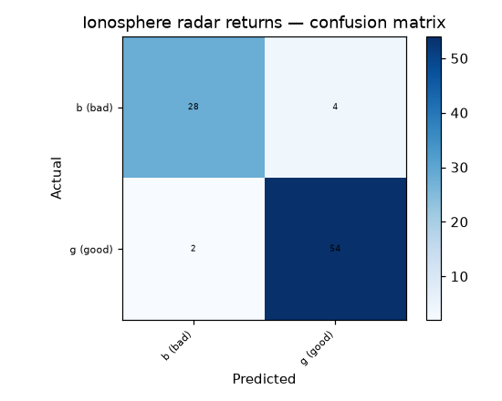

# 42 · Ionosphere Radar Return Classification

**Result: 93.2% accuracy** (Random Forest) · Logistic Regression 89.8% · always predicting the majority class ('good') scores 64.1%.

## The problem
Radar returns from the ionosphere come in two kinds: 'good' returns show evidence of structure in the ionosphere, 'bad' ones show none. Telling them apart automatically is a classic small-data binary classification benchmark.

## Data
UCI Ionosphere — 351 returns, 33 usable features (the dataset has 34 attributes, but the second is constant 0 for every row and is dropped). Labels: g = 225, b = 126.

## Approach
- Stratified 75/25 split
- Random Forest (300 trees) vs scaled logistic regression

## Run it
Open `ionosphere_radar.ipynb` in Jupyter or Colab; it downloads the UCI dataset itself.

## Stack
Python · pandas · scikit-learn · matplotlib
