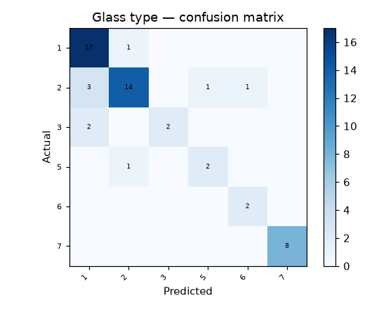

# 43 · Glass Type Identification

**Result: 83.3% accuracy** (Random Forest) · Logistic Regression 70.4% · largest-class baseline 35.5%.

## The problem
At a crime scene, a glass fragment is evidence only if you can say what it came from. Glass chemistry (refractive index + oxide composition) varies systematically by use — this is the classic UCI forensic classification task.

## Data
UCI Glass Identification — 214 samples, 9 features (refractive index; Na, Mg, Al, Si, K, Ca, Ba, Fe percentages). The leading Id-number column is dropped.

## Honest note
The class labels are 1, 2, 3, 5, 6, 7 — **class 4 (vehicle windows, non-float processed) is absent from this dataset entirely**, so no model trained on it can ever predict that type. With only 214 samples and some classes as small as 9 examples, per-class scores vary a lot; treat this as a demonstration, not a forensic tool.

## Classes
- 1: building windows (float)
- 2: building windows (non-float)
- 3: vehicle windows (float)
- 5: containers
- 6: tableware
- 7: headlamps

## Approach
- Stratified 75/25 split
- Random Forest (300 trees) vs scaled logistic regression

## Run it
Open `glass_type_identification.ipynb` in Jupyter or Colab; it downloads the UCI dataset itself.

## Stack
Python · pandas · scikit-learn · matplotlib
