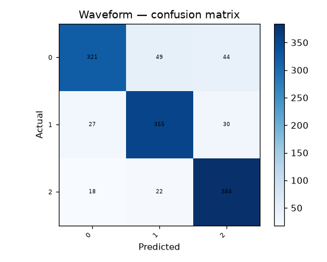

# 45 · Waveform Classification

**Result: 84.8% accuracy** (Random Forest) · Logistic Regression 86.8% · largest-class baseline 33.9%.

## The problem
The Waveform dataset is generated, not measured: three triangular base waves are combined in pairs, sampled at 21 points, and corrupted with noise. Each combination is a class. It is a clean test-bed because the theoretically best achievable accuracy is known (the Bayes rate is ≈86%).

## Data
UCI Waveform Database Generator (Version 1) — 5000 samples, 21 continuous features, 3 roughly balanced classes. The notebook downloads the CSV UCI serves for this dataset (the original archive files are in the obsolete .Z format).

## Approach
- Stratified 75/25 split
- Random Forest (300 trees) vs scaled logistic regression

## Run it
Open `waveform_classification.ipynb` in Jupyter or Colab; it downloads the UCI dataset itself.

## Stack
Python · pandas · scikit-learn · matplotlib
