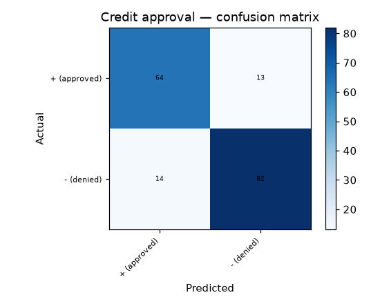

# 46 · Credit Approval Prediction

**Result: 84.4% accuracy** (Random Forest) · Logistic Regression 83.8% · always predicting the majority class ('−', denied) scores 55.5%.

## The problem
Should this application be approved? This is the well-known UCI Credit Approval (crx) benchmark — the features were anonymised by the dataset's creators, so the model learns the *pattern* of past decisions without anyone knowing what A9 or A11 actually measure.

## Data
UCI Credit Approval — 690 applications, 15 attributes (6 numeric, 9 categorical) plus the +/− decision. 67 values are missing (the numeric ones parse as NaN, the categorical ones are marked `?`).

## Approach
- Missing values: median for numeric attributes, an explicit `missing` category for categorical ones
- Categorical attributes one-hot encoded → 51 model features
- Stratified 75/25 split
- Random Forest (300 trees) vs scaled logistic regression

## Honest note
The model imitates historical human decisions, biases included — reproducing an old approval rule is not the same as making a fair one. This is a benchmark exercise, not a lending tool.

## Run it
Open `credit_approval.ipynb` in Jupyter or Colab; it downloads the UCI dataset itself.

## Stack
Python · pandas · scikit-learn · matplotlib
