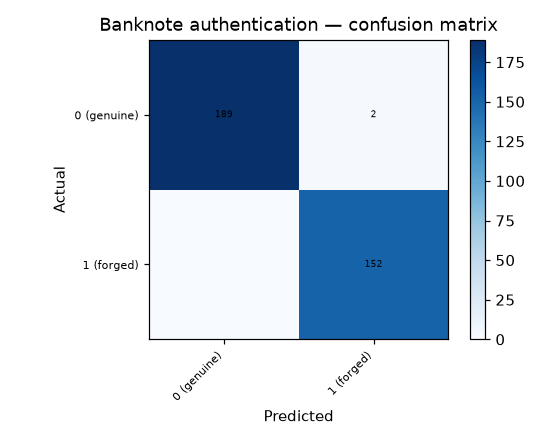

# 47 · Banknote Authentication

**Result: 99.4% accuracy** (Random Forest) · Logistic Regression 97.4% · always predicting the majority class (genuine) scores 55.5%.

## The problem
Counterfeit detection from image statistics: if the wavelet signature of a real note differs measurably from a forged one, a classifier can screen notes without chemical or watermark tests.

## Data
UCI Banknote Authentication — 1372 notes (762 genuine, 610 forged), 4 features: variance, skewness, curtosis and entropy of the wavelet-transformed note image. (UCI spells the third column `curtosis`.)

## Approach
- Stratified 75/25 split
- Random Forest (300 trees) vs scaled logistic regression

## Run it
Open `banknote_authentication.ipynb` in Jupyter or Colab; it downloads the UCI dataset itself.

## Stack
Python · pandas · scikit-learn · matplotlib
