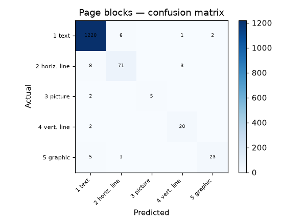

# 48 · Page Blocks Classification

**Result: 97.8% accuracy** (Random Forest) · Logistic Regression 96.6% · always predicting 'text' scores 89.8%.

## The problem
Before OCR can read a scanned page, the page has to be segmented and each block typed: is this region text, a rule line, a picture, or a graphic? This dataset (from scanned documents, via the SCRIBES system) is the classic benchmark for that block-typing step.

## Data
UCI Page Blocks Classification — 5473 blocks, 10 features (height, length, area, eccentricity, black-pixel ratios, transition counts).

## Classes
- 1: text — 4913 blocks
- 2: horizontal line — 329 blocks
- 3: picture — 28 blocks
- 4: vertical line — 88 blocks
- 5: graphic — 115 blocks

## Honest note
Almost 90% of blocks are text, so the headline accuracy flatters every model — the interesting question is the minority classes, and picture blocks (only 28 examples) are the hardest. Check the per-class report in the notebook and the confusion matrix below, not just the single accuracy number.

## Approach
- Stratified 75/25 split
- Random Forest (300 trees) vs scaled logistic regression

## Run it
Open `page_blocks_classification.ipynb` in Jupyter or Colab; it downloads the UCI dataset itself.

## Stack
Python · pandas · scikit-learn · matplotlib
