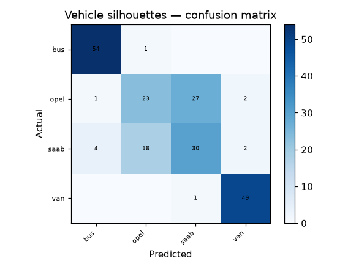

# 49 · Vehicle Silhouette Classification

**Result: 73.6% accuracy** (Random Forest) · Logistic Regression 82.1% · largest-class baseline 25.7%.

## The problem
Vehicle recognition from a single silhouette: given only shape statistics of a 2D outline, decide whether the vehicle is a bus, a van, an Opel Manta or a Saab 9000 (Statlog dataset).

## Data
UCI Statlog Vehicle Silhouettes — 845 usable samples, 18 shape features, 4 classes (bus, opel, saab, van).

## Data quirk
UCI's merged CSV ships 846 rows, but one of them is corrupted — its values are shifted across columns and its class label reads `204` instead of a vehicle name. That row is dropped before training, and the notebook shows the drop explicitly.

## Approach
- Stratified 75/25 split
- Random Forest (300 trees) vs scaled logistic regression

## Run it
Open `vehicle_silhouettes.ipynb` in Jupyter or Colab; it downloads the UCI dataset itself.

## Stack
Python · pandas · scikit-learn · matplotlib
