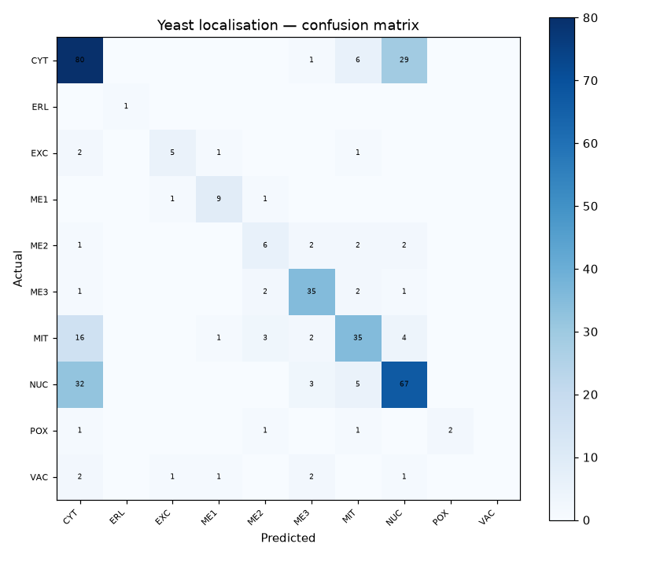

# 50 · Yeast Protein Localisation Prediction

**Result: 64.7% accuracy** (Random Forest) · Logistic Regression 59.3% · always predicting the majority class (CYT, cytosol) scores 31.2%.

## The problem
Proteins are sorted to compartments inside the cell, and the sorting instructions are written in their amino-acid sequence. This benchmark predicts a yeast protein's localisation site from 8 sequence-derived scores — a foundational problem in computational biology.

## Data
UCI Yeast — 1484 proteins, 8 features (mcg, gvh, alm, mit, erl, pox, vac, nuc — motif and signal scores). The protein name column is an identifier and is dropped.

## Classes
- CYT: 463 proteins
- ERL: 5 proteins
- EXC: 35 proteins
- ME1: 44 proteins
- ME2: 51 proteins
- ME3: 163 proteins
- MIT: 244 proteins
- NUC: 429 proteins
- POX: 20 proteins
- VAC: 30 proteins

## Honest note
This dataset is **heavily imbalanced**, and it matters: CYT and NUC together are ~60% of all proteins, while ERL has only 5 samples in the entire dataset — about one lands in the test split, so its per-class score is meaningless, and POX (20), VAC (30) and ME1 (44) are barely better. Both models effectively learn the big classes and mostly miss the rare ones. Read the per-class report and the confusion matrix, not the headline accuracy — this project is as much a demonstration of what class imbalance does as it is a classifier.

## Approach
- Stratified 75/25 split
- Random Forest (300 trees) vs scaled logistic regression

## Run it
Open `yeast_classification.ipynb` in Jupyter or Colab; it downloads the UCI dataset itself.

## Stack
Python · pandas · scikit-learn · matplotlib
